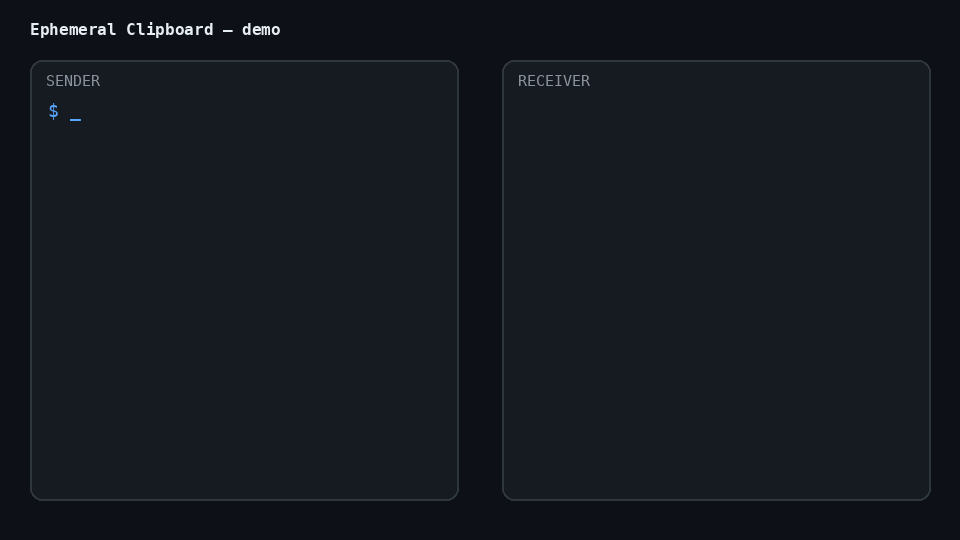
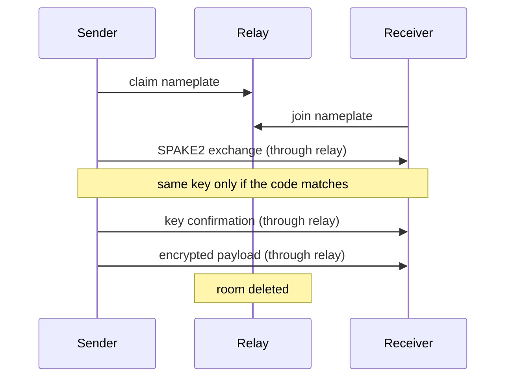

<p align="center">
  
</p>

<h1 align="center">Ephemeral Clipboard</h1>

<p align="center">
  
</p>

<p align="center">
  Send a secret from one computer to another. Read once, then gone.<br>
  End-to-end encrypted. The relay never sees your data.
</p>

<p align="center">
  
  
  
  
</p>

---

> **Status:** In development. See [`docs/project-plan.md`](docs/project-plan.md).

## Why

You need a password or an API key on another computer. Chat apps and email keep a copy forever. Cloud clipboards sync it to a server. A shared note stays open.

Ephemeral Clipboard sends the secret once, encrypted from end to end, and then deletes it everywhere it can.

## How to use it

On the first computer:

```text
$ eclip send
Read 32 characters from the clipboard.
Code: 7-guitar-orbit
Waiting for receiver… (expires in 4:59)
```

On the second computer:

```text
$ eclip receive 7-guitar-orbit
Received. Copied to the clipboard. It will be cleared in 30 s.
```

That is all. The secret is now deleted from the relay.

## Features

- **Short, safe codes.** The code (`7-guitar-orbit`) is easy to read out. SPAKE2 key exchange makes a short code safe: each guess needs a live connection, and the room closes after 3 wrong codes.
- **Zero-knowledge relay.** The relay forwards encrypted messages and keeps them in RAM only. It never gets the code, the key or the plaintext.
- **Burn after reading.** The relay deletes the room after delivery, or after 5 minutes if nobody receives it.
- **Clipboard hygiene.** The received value is cleared after 30 seconds, but only if it is still on the clipboard. On Windows and KDE, it is kept out of clipboard history.
- **Key protection.** The derived key is held in locked memory and zeroed after use.
- **Self-hostable relay.** Run `eclip serve`, or use the Docker image.

## How it works



The full protocol is in [`docs/PROTOCOL.md`](docs/PROTOCOL.md).

## Install

```sh
pipx install ephemeral-clipboard
```

Or download a binary from GitHub Releases.

**Linux:** install `wl-clipboard` (Wayland) or `xclip` (X11).

## Commands

| Command | Description |
| --- | --- |
| `eclip send` | Send the clipboard contents and show a code |
| `eclip receive <code>` | Receive a secret into the clipboard |
| `eclip serve` | Run your own relay |

Use `--relay wss://your-relay.example` to select a relay.

## Compared with magic-wormhole

[magic-wormhole](https://github.com/magic-wormhole/magic-wormhole) uses the same SPAKE2 idea and is the main inspiration. Ephemeral Clipboard is smaller and has a different focus:

| | Ephemeral Clipboard | magic-wormhole |
| --- | --- | --- |
| Main use | Clipboard secrets | Files, folders and text |
| Clipboard read and write | Built in | Not built in |
| Auto-clear and history exclusion | Yes | No |
| Relay storage | RAM only, one read, TTL | Mailbox server |

## Security

- The relay never gets the code, the key or the plaintext.
- A short code cannot be cracked offline (SPAKE2).
- A changed ciphertext fails to decrypt (ChaCha20-Poly1305).
- Payloads, keys and codes are never logged.

**Known limits:**

- Python makes copies of the plaintext in normal memory. These copies cannot be zeroed. Locked memory protects the key, not the plaintext.
- The OS clipboard and the app you paste into keep their own copies.
- The relay can see metadata: IP addresses, times and payload size.

Read [`docs/threat-model.md`](docs/threat-model.md) for details. To report a vulnerability, read [`SECURITY.md`](SECURITY.md).

## Contributing

Read [`CONTRIBUTING.md`](CONTRIBUTING.md). To claim an issue or ask a question, join the [PulseEngine Discord](https://discord.gg/VU8RUByEeG).

## License

[MIT](LICENSE) © 2026 PulseEngine
