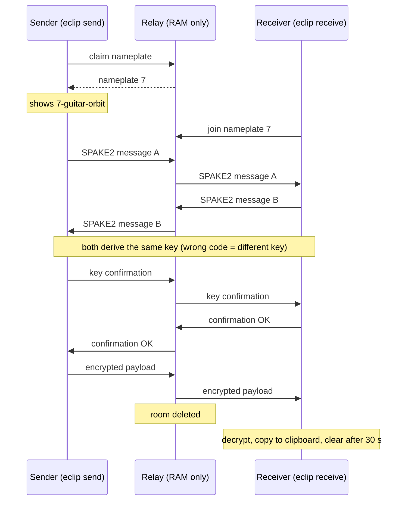

# Ephemeral Clipboard: Project Plan

## 1. Goal and scope

Ephemeral Clipboard sends one secret (password, API key, token) from one computer to another. The relay never sees the plaintext. The secret is deleted after one read or when its time runs out. Target: a finished, documented PulseEngine repo in about 3 weeks.

The user flow:

1. Sender runs `eclip send`. The tool shows a code, for example `7-guitar-orbit`.
2. Receiver runs `eclip receive 7-guitar-orbit`.
3. The secret goes to the receiver's clipboard. It is cleared after 30 seconds.

The CLI name is `eclip`, not `clip`, because Windows already has `clip.exe`.

### In scope

- `eclip send`, `eclip receive <code>`, `eclip serve`
- SPAKE2 key exchange from a short word code
- HKDF-SHA256 key derivation and ChaCha20-Poly1305 encryption
- Key confirmation, so a wrong code fails before any payload is sent
- `asyncio` WebSocket relay: RAM only, one read, TTL, limits
- Native clipboard access: Win32 through `ctypes` on Windows, `wl-copy` / `xclip` on Linux
- Clipboard history exclusion on Windows and KDE
- Auto-clear of the clipboard, only if it still holds the received value
- `SecureBuffer` with `mlock` / `VirtualLock` and zeroing, for key material only
- Written protocol spec (`docs/PROTOCOL.md`)
- Malicious-relay tests and property-based tests
- Docker image for the relay; TLS through a reverse proxy
- `pipx` install and PyInstaller binaries

### Out of scope

- Phone client and GUI
- File transfer
- More than one receiver
- macOS support
- Full memory hygiene for plaintext (not possible in Python; see section 4)

---

## 2. The code

A code has the form `<nameplate>-<word>-<word>`.

- **Nameplate** (`7`): a short number. The relay uses it to connect sender and receiver. It is not secret.
- **Words** (`guitar-orbit`): two words from a 256-word list. This is the SPAKE2 password (16 bits).

16 bits is enough because SPAKE2 allows only one guess for each live connection. An attacker cannot test guesses offline. With 3 attempts, the chance of a correct guess is 3 in 65,536, and then the room closes.

---

## 3. Architecture



Both clients must be online at the same time. The sender waits and shows "Waiting for receiver… (expires in 4:59)".

---

## 4. Security requirements

Each requirement gets a test.

| # | Requirement | Stops |
| --- | --- | --- |
| 1 | Relay only forwards messages; it never gets the code or the key | A malicious relay that reads secrets |
| 2 | SPAKE2 key exchange; no data from which a guess can be tested offline | Offline brute force of the short code |
| 3 | Key confirmation before the payload; max 3 failed attempts, then the room closes | Online guessing |
| 4 | ChaCha20-Poly1305 with a key used only once | Tampering with the ciphertext |
| 5 | Relay keeps rooms in RAM only and deletes a room after delivery | Data left on the server |
| 6 | Room TTL (default 5 minutes) | Old secrets that wait forever |
| 7 | Relay limits: payload size (64 KB), open rooms, connections per IP | Denial of service |
| 8 | `wss://` for public relays | Network attackers that see metadata |
| 9 | Clipboard cleared after 30 s, only if it still holds the received value | Secret left on the clipboard; user's newer data deleted |
| 10 | Clipboard history exclusion on Windows and KDE | Secret saved in clipboard history |
| 11 | Derived key held in a locked `SecureBuffer` and zeroed after use | Key written to swap or left in memory |
| 12 | Never log or print payloads, keys or codes | Leaks through logs |

**Known limit:** Python creates copies of the plaintext in normal memory (`str`, `bytes`). These copies cannot be zeroed. `SecureBuffer` protects the key, not the plaintext. Write this in the README threat model.

---

## 5. Milestones

Three weeks, one milestone each week. Each week ends with a working, tagged build.

### Week 1: Protocol and relay (`v0.1.0`)

- [x] Repo setup: `pyproject.toml`, MIT license, CI (lint, type check, tests) for Windows and Linux
- [x] Write `docs/PROTOCOL.md`: message types, state machine, version field, error codes
- [x] Relay: nameplates, rooms, message forwarding, delete after delivery
- [x] Relay: TTL, payload and room limits, cap on connections per IP (#7)
- [x] Tests: one read only, TTL expiry, limits

### Week 2: Client and crypto (`v0.2.0`)

- [ ] Word list and code generation
- [ ] SPAKE2 exchange, HKDF, key confirmation, ChaCha20-Poly1305
- [ ] `SecureBuffer` for the derived key, with tests
- [ ] `eclip send` and `eclip receive` (clipboard read and write through `pyperclip` for now)
- [ ] Malicious-relay tests: a recording relay cannot recover the code or the plaintext; a changed ciphertext fails
- [ ] Property-based tests with `hypothesis` for the round trip and the protocol parser

### Week 3: Native clipboard and release (`v1.0.0`)

- [ ] Windows clipboard through `ctypes` with history exclusion formats
- [ ] Linux clipboard through `wl-copy` / `xclip` with the KDE password hint
- [ ] Remove `pyperclip`; add auto-clear with value check
- [ ] Dockerfile for the relay and a Caddy example for TLS
- [ ] PyInstaller binaries and `pipx` install
- [ ] README, threat model, comparison with magic-wormhole, demo GIF
- [ ] Go through the definition of done, then mark the repo complete

---

## 6. Tech stack and repository layout

| Part | Choice |
| --- | --- |
| Language | Python 3.11+ |
| Key exchange | `spake2` |
| Crypto | `cryptography` (HKDF-SHA256, ChaCha20-Poly1305) |
| Networking | `websockets` + `asyncio` |
| Memory | `ctypes` (`mlock`, `VirtualLock`) |
| Tests | `pytest`, `pytest-asyncio`, `hypothesis` |
| Quality | `ruff`, `mypy` |
| Release | PyInstaller, `pipx`, Docker |
| License | MIT |

```text
ephemeral-clipboard/
├── pyproject.toml
├── src/eclip/
│   ├── cli.py              # send, receive, serve
│   ├── protocol.py         # version, error codes, message parser
│   ├── pake.py             # SPAKE2, HKDF, key confirmation
│   ├── crypto.py           # ChaCha20-Poly1305
│   ├── secure_mem.py       # SecureBuffer (mlock / VirtualLock + zeroing)
│   ├── wordlist.py         # code words
│   ├── relay.py            # asyncio WebSocket relay, TTL, limits
│   └── clipboard/
│       ├── windows.py      # Win32 via ctypes, history exclusion
│       └── linux.py        # wl-copy / xclip, KDE hint
├── tests/
│   ├── test_relay.py
│   ├── test_protocol.py
│   ├── test_crypto.py
│   ├── test_secure_mem.py
│   └── test_malicious_relay.py
├── deploy/
│   ├── Dockerfile
│   └── Caddyfile
├── docs/
│   ├── PROTOCOL.md
│   └── threat-model.md
└── assets/logo.png
```

---

## 7. Definition of done

When all items are ticked, tag `v1.0.0` and mark the repo as complete.

- [ ] `eclip send` and `eclip receive` work between Windows 11 and Arch Linux
- [ ] A wrong code fails without a payload transfer, and the room closes after 3 failures
- [ ] Malicious-relay tests pass
- [ ] All 12 security requirements have passing tests
- [ ] CI is green on Windows and Linux
- [ ] `docs/PROTOCOL.md` and `docs/threat-model.md` are complete
- [ ] README has: one-line pitch, demo GIF, install, quick start, comparison with magic-wormhole, threat model link
- [ ] Binaries are on GitHub Releases; the relay Docker image builds
- [ ] No open issue marked `bug`

---

## 8. Risks and cuts

| Risk | Fallback |
| --- | --- |
| Clipboard history exclusion does not work on some setups | Document which setups work; keep auto-clear |
| Wayland clipboard tools are not installed | Detect it and show the install command |
| PyInstaller binaries are flagged by antivirus | Make `pipx` the main install method |
| Scope grows (GUI, phone, files) | Put each idea in a `v2-ideas` issue, do not build it |

If time runs out, cut in this order:

1. PyInstaller binaries (keep `pipx`)
2. KDE history hint (keep Windows exclusion)
3. Docker image (keep `eclip serve`)

Never cut SPAKE2, key confirmation, the malicious-relay tests or the protocol spec.
